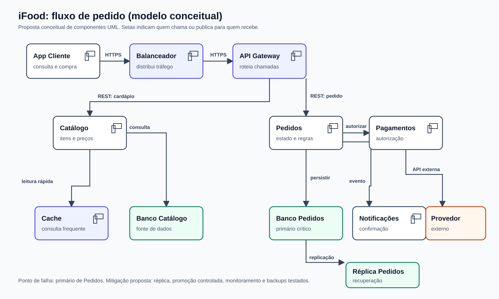

# Semana 01 — diagrama de componentes UML

## Sistema e recorte

O **iFood** é a referência de sistema conhecido para este exercício. O recorte considera somente o fluxo em que o cliente consulta o cardápio, cria um pedido, solicita autorização de pagamento e recebe a confirmação. A arquitetura abaixo é uma **proposta conceitual** para estudar esse fluxo; não representa nem afirma conhecer a arquitetura interna real do iFood.

O arquivo [diagrama_componentes.puml](diagrama_componentes.puml) guarda a fonte editável do diagrama. O SVG pode ser aberto diretamente no GitHub ou exportado para PDF.

## Componentes e responsabilidades

| Componente | Responsabilidade |
| --- | --- |
| App Cliente | Exibir cardápio, montar carrinho e acompanhar o pedido. |
| Balanceador | Distribuir requisições entre instâncias do gateway. |
| API Gateway | Autenticar a chamada, aplicar limites e encaminhar para os serviços. |
| Serviço de Catálogo | Consultar restaurantes, pratos e preços disponíveis. |
| Serviço de Pedidos | Validar itens e estado do pedido; coordenar a criação. |
| Serviço de Pagamentos | Solicitar autorização ao provedor externo e registrar o resultado. |
| Serviço de Notificações | Enviar a confirmação ao cliente após o evento de pedido confirmado. |
| Cache | Acelerar consultas frequentes do catálogo, sem ser a fonte principal. |
| Bancos de Catálogo e Pedidos | Persistir os dados de cada domínio; o banco de pedidos usa réplica para leitura e recuperação. |

## Interfaces e fluxo

1. O App Cliente envia uma chamada HTTPS ao Balanceador, que a distribui para uma instância do API Gateway.
2. O Gateway consulta o Catálogo por API REST para mostrar itens e preços. O Catálogo usa o Cache quando há uma entrada válida e consulta seu banco quando necessário.
3. Ao confirmar a compra, o Gateway chama o Serviço de Pedidos. Ele verifica o estado dos itens e pede autorização ao Serviço de Pagamentos, que fala com um provedor externo.
4. Após a autorização, Pedidos grava o pedido e publica o evento `PedidoConfirmado`. Notificações consome esse evento e informa o cliente. Em caso de falha no pagamento, o pedido não deve receber o estado confirmado.

As setas do diagrama partem do componente que chama ou publica e apontam para quem recebe. APIs REST são síncronas; o evento de confirmação é assíncrono.

## Escala e ponto de falha

O Balanceador e o Cache são componentes de infraestrutura/escala. O banco primário de pedidos ainda é crítico: se ele parar, novas confirmações ficam indisponíveis. Uma réplica com promoção controlada, backups testados e monitoramento reduz esse ponto único de falha. A réplica sozinha não elimina indisponibilidade nem substitui backup.

## Reflexão

Desenhar a arquitetura antes do código obriga a definir responsabilidades e interfaces, expondo dependências e possíveis gargalos quando ainda é barato corrigi-los. O diagrama ajuda a equipe técnica a discutir limites e contratos; para gestores, mostra o caminho de uma compra e as consequências de falhas sem exigir leitura do código. O desenho deve ser revisado quando requisitos e restrições mudarem.

Fonte do enunciado: [AVA — Arquitetura de Software, Semana 01](https://ead.ceuma.br/mod/assign/view.php?id=25613).
