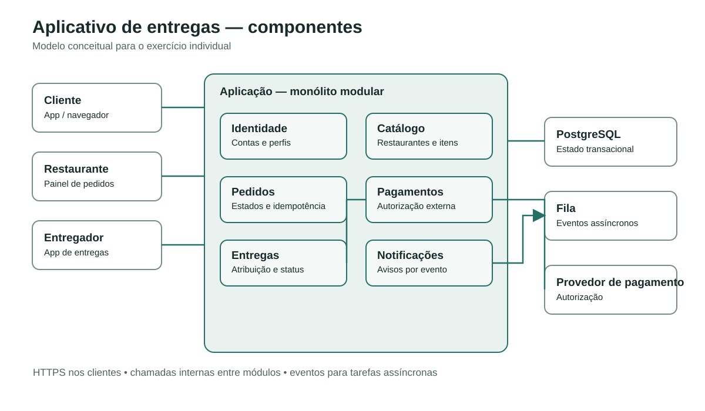
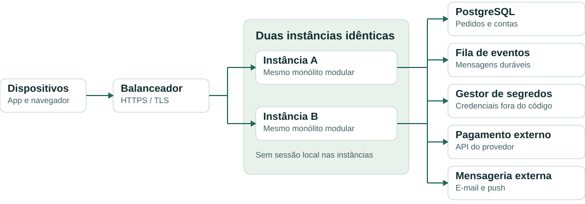

# Projeto final individual — arquitetura de um aplicativo de entregas

**Aluno:** Alvaro Simeao Castelo Branco  
**Disciplina:** Arquitetura de Software  
**Cenário:** aplicativo de entregas fictício, usado como exemplo no enunciado do AVA.

## 1. Contexto e requisitos

Clientes consultam restaurantes, montam pedidos, pagam e acompanham a entrega. Restaurantes recebem e aceitam pedidos. Entregadores disponíveis aceitam corridas e atualizam o estado da entrega. A equipe operacional atende exceções, como cancelamento, pagamento recusado e indisponibilidade de entregadores.

Requisitos funcionais: cadastrar e autenticar os três perfis; publicar catálogo; criar pedido com itens e endereço; calcular preço e taxa; autorizar pagamento; permitir aceite do restaurante; atribuir entregador; registrar mudanças de estado; exibir acompanhamento e histórico; cancelar conforme o estágio do pedido.

Restrições assumidas para este exercício: equipe pequena, orçamento limitado, operação inicial em uma cidade e provedor de pagamentos externo. A aplicação evita armazenar dados de cartão. O aplicativo deve preservar pedidos confirmados em falhas temporárias e impedir cobrança duplicada em tentativas repetidas.

## 2. Atributos de qualidade priorizados

| Ordem | Atributo | Motivo | Critério de verificação proposto |
| --- | --- | --- | --- |
| 1 | Confiabilidade | Pedido pago e entrega precisam manter estados consistentes. | Repetir a mesma solicitação de criação sem gerar novo pedido ou nova cobrança. |
| 2 | Segurança | Contas, endereços e pagamentos exigem proteção. | Testar autorização por perfil, registro de acessos e ausência de dados de cartão nos logs. |
| 3 | Desempenho | A navegação pelo catálogo e o acompanhamento dependem de resposta rápida. | Medir percentil 95 do catálogo e do status sob carga representativa antes de definir a meta. |
| 4 | Manutenibilidade | A equipe pequena precisa evoluir regras de pedido e entrega. | Componentes com responsabilidades claras e testes de contrato nas integrações. |
| 5 | Escalabilidade | A demanda pode crescer após a validação inicial. | Testar crescimento de pedidos e consumo de eventos sem perder mensagens. |

A classificação usa os conceitos da ISO/IEC 25010 como referência. As métricas são propostas de teste, ainda sem linha de base real.

## 3. Decisão arquitetural

Adotar um **monólito modular** com módulos de Identidade, Catálogo, Pedidos, Pagamentos, Entregas e Notificações. O cliente acessa uma API HTTPS. O módulo de Pedidos governa a transição de estados e persiste uma chave de idempotência por solicitação. Pagamentos chama o provedor externo por adaptador. Uma fila transporta eventos de pedido confirmado e entrega atribuída para tarefas assíncronas. Integrações mantêm identificadores de correlação e repetem falhas transitórias com limite.

A decisão reduz o custo operacional inicial e mantém transações do núcleo de pedidos em um banco PostgreSQL. O preço é um deploy coordenado e a necessidade de preservar limites claros entre módulos. A divisão em serviços independentes fica condicionada a medições de capacidade e à existência de equipes capazes de operar sistemas distribuídos.

## 4. Diagrama de componentes

O módulo de Pedidos recebe a intenção de compra, consulta os itens do Catálogo, grava o pedido e coordena o resultado do pagamento. Entregas recebe pedidos aptos ao envio. Notificações comunica mudanças ao cliente e ao restaurante. Identidade autentica contas e autoriza ações por perfil.

## 5. Diagrama de implantação

O navegador ou aplicativo móvel usa HTTPS até um balanceador. Duas instâncias idênticas do monólito podem atender requisições. PostgreSQL guarda o estado persistente. A fila desacopla notificações e tarefas de entrega. O serviço externo de pagamentos recebe apenas as informações necessárias à autorização. Segredos ficam em um cofre ou gerenciador de segredos, fora do código.

## 6. Falhas e trade-offs

- Pagamento recusado mantém o pedido em estado não confirmado e informa o cliente.
- Timeout do provedor leva a consulta de status pelo identificador de operação antes de nova tentativa. A chave de idempotência evita duplicidade.
- Falha na fila mantém o evento em uma tabela de saída transacional até publicação confirmada.
- Falha de notificação não altera a confirmação do pedido. A mensagem pode ser repetida.
- Ausência de entregadores mantém o pedido em espera operacional e sinaliza a previsão como indisponível.
- Falha de uma instância do monólito permite que a outra continue, desde que banco e balanceador estejam disponíveis. O banco requer backup e teste de restauração.

## 7. Rubrica para peer review

| Critério | 0 ponto | 1 ponto | 2 pontos |
| --- | --- | --- | --- |
| Requisitos e contexto | Ausentes | Parciais | Claros e coerentes |
| Componentes | Ausentes | Responsabilidades vagas | Responsabilidades e integrações claras |
| Implantação | Ausente | Nós incompletos | Nós, dependências e fluxos claros |
| Qualidade e decisões | Sem justificativa | Justificativa parcial | Prioridades e trade-offs explícitos |
| Falhas e segurança | Ignoradas | Cobertura parcial | Respostas e limites descritos |

Total de 10 pontos. Esta rubrica está pronta para avaliar outro grupo. A apresentação oral e a avaliação efetiva dependem da atividade com a turma e não são declaradas como realizadas.

**Fonte do enunciado:** [AVA — Arquitetura de Software, Semana 04](https://ead.ceuma.br/mod/assign/view.php?id=25614).